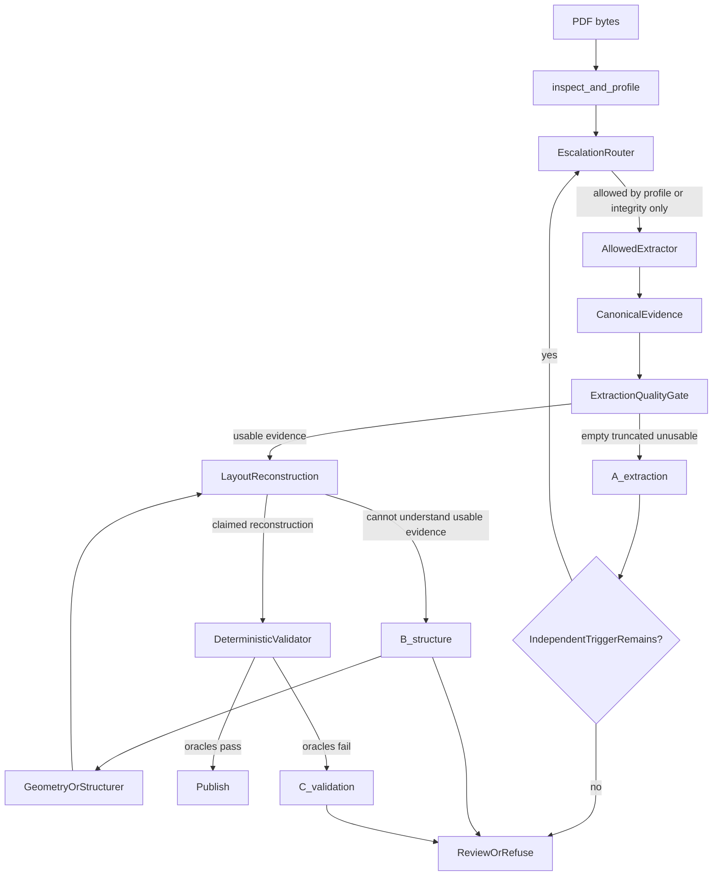

# Phase 2 Architecture Plan

```
STATUS: ACCEPTED ARCHITECTURE PLAN
IMPLEMENTATION: PHASE 2.0 (SAFETY FOUNDATIONS) IN PROGRESS since 2026-09-01 — see docs/agent-handoffs/PHASE2-0-SAFETY.md
OQ1–OQ11: RULED 2026-09-01 — see PHASE2_RULINGS.md (binding; this plan's "architecture intent" yields to the rulings)
FROZEN REGRESSION FLOOR: 2,625
```

| | |
|---|---|
| **STATUS** | **ACCEPTED ARCHITECTURE PLAN** |
| **IMPLEMENTATION** | **PHASE 2.0 IN PROGRESS** (2026-09-01; umbrella card `docs/agent-handoffs/PHASE2-0-SAFETY.md`; cells P20-ROUTER / P20-POSTPROCESS / P20-SEAM / P20-ARTIFACTS / P20-SURFACES). Phase 2.1+ NOT authorized. |
| **FROZEN REGRESSION FLOOR** | **2,625** |
| Date | 2026-09-01 |
| Freeze | `batch9-final` (commit `819d97d`) |
| Authority | Architecture. OQ1–OQ11 are ruled in [PHASE2_RULINGS.md](PHASE2_RULINGS.md); where this plan's intent and a ruling differ, the ruling wins. |

This is the accepted Phase 2 architecture plan. Read it before any Phase 2 implementation. **Gustavo ruled OQ1–OQ11 on 2026-09-01** ([PHASE2_RULINGS.md](PHASE2_RULINGS.md)) and authorized Phase 2.0 only; the verbatim questions stay in [OCR_LEGACY_AUDIT.md](OCR_LEGACY_AUDIT.md) §6 and [PHASE2_HANDOFF.md](../../PHASE2_HANDOFF.md) as history.

It follows [PHASE2_HANDOFF.md](../../PHASE2_HANDOFF.md), [OCR_LEGACY_AUDIT.md](OCR_LEGACY_AUDIT.md), and Batch 9 freeze `batch9-final` (2,625 / 3,380 validated).

## Governing rules

These rules are accepted architecture. They survive every Phase 2 milestone.

- Validator success may **stop** escalation.
- Validator failure may **never start** escalation.
- Class A = extraction failure (ExtractionQualityGate, before reconstruction or financial validation).
- Class B = structural / layout failure (after reconstruction cannot understand usable evidence).
- Class C = financial validation failure (only after a claimed reconstruction fails financial oracles).
- OCR is evidence acquisition only.
- Same deterministic validator. Only that validator grants `validated`.
- Frozen regression floor = 2,625. A coverage gain never cancels a regression.
- No source-value rewriting to force reconciliation.
- PaddleOCR is the primary visual extractor (geometry engine, not merely another text string).
- Geometry / generalized reconstruction comes **before** Unlimited OCR.
- Unlimited OCR is a bounded generative fallback only.

**Non-negotiable**

- Frozen regression floor = 2,625. A coverage gain never cancels a regression.
- Same deterministic validator. OCR is evidence acquisition only.
- No source-value rewriting to force reconciliation.
- Validator success may **stop** escalation. Validator failure alone may **never start** it.

**Governing facts**

- Visual Unlimited-OCR produced **0 / 3,506** artifacts. All 2,625 validated statements rest on native PDF text (3,297) plus Tesseract (179). Phase 2 is audit-and-enable, not a proven OCR revival.
- Scan/image residue already measured: R (`deferred_visual_ocr`) = 13, U (unclaimed Tesseract) = 123, **R ∪ U = 136 / 3,506 (<4%)**, overlap 0, **validated ∩ (R ∪ U) = 0**.
- Native/layout residue is much larger: 3,380 − 2,625 = **755** non-validated corpus docs, of which discovery estimated **~660 unclaimed known-bank native layouts**. OCR will not move those.
- Enable path already exists in [discovery/runner.py](../../discovery/runner.py) and has never run. The existing U trigger (`dispatch.outcome != claimed`) **conflates extraction failure with structural failure**. Phase 2 must split it.
- The 2026-07 PaddleOCR spec is a standalone parser that also decides structure. Inherit bbox reconstruction; supersede the parser/JSON architecture.

---

## Competitive reality (what the product must become)

Ocrolus is not an OCR vendor. It sells **lender decision infrastructure**: document understanding + cash-flow/income analytics + fraud (Resistant AI) + maker-checker models + SOC-clean-room humans for a 99%+ SLA + API/LOS.

MoneyThumb is closer to this codebase's thesis: **deterministic structural parse first** (~90% native PDF, relational geometry, no per-bank templates), OCR only for scans, reconciliation as the publish gate, Thumbprint fraud, and an underwriting scorecard.

Honest gap vs both: unknown-bank generality, scan throughput, PDF tamper forensics, package/month-map underwriting views, public API. Batch 9 already beats both on ledger/ADB/reconciliation rigor ([PARITY_MATRIX.md](PARITY_MATRIX.md)).

Phase 2 has **two coverage goals**, not one:

- **Scan/image coverage** — make scanned/mixed statements first-class; measure gain from the ~136 residue.
- **Layout generalization** — reduce dependence on parser #85, #86, #87; recover native *and* OCR-derived documents through geometry.

OCR itself is not the path from 77.66% to 90%+.

---

## 1. Target architecture

Yes, a common extractor interface. Do **not** build a new framework beside [ocr/pipeline.py](../../ocr/pipeline.py). Wrap the existing ladder. Tesseract remains a named production rung (36 validated).

The previous diagram was wrong in one respect that is easy to ship by accident: it chained `validator claimed? -> if no, next extractor`. That is searching until reconciliation. The router and the validator are **separate authorities**. Class A is assigned by an **ExtractionQualityGate** on canonical evidence, before reconstruction or financial validation. Empty, truncated, or otherwise unusable extractor output returns to the EscalationRouter without invoking the financial validator. Class B is assigned only after reconstruction cannot understand *usable* evidence. Class C is assigned only after a claimed reconstruction fails financial oracles. The validator has no edge to Class A or to any extractor.



**Invariant, in one sentence:** the validator may halt further extraction; it may not request further extraction; Class A cannot be produced by validator failure.

**Who is allowed to start an extractor**

Only the **EscalationRouter**, and only from **document-profile / extraction-quality** evidence that exists *before* financial oracles run, or from integrity flags that are not financial:

- image-only page / `classification=scanned`
- empty native text on a page (`native_text_total_chars == 0` / Trigger R)
- mixed PDF page with missing native text (`classification=mixed` and that page below the text threshold)
- known truncation / `page_integrity` flag (Trigger T, admitted only after measurement)
- extractor failed to produce **usable evidence** (empty, below char floor, truncated, raster failure, endpoint death)

**Who is forbidden from starting an extractor**

- parser gap / unclaimed dispatch on otherwise usable text (that is class B)
- reconciliation failure, ADB withhold, coverage miss, currency miss, period miss (class C)
- “the other engine might make it balance”

Default extractor order for a page that the router has **already** allowed as image/scanned:

`Native (if any text) -> Tesseract -> PaddleOCR -> Unlimited OCR`

That order is a **preference among allowed extractors**, not a retry loop driven by validation. Native is skipped on image-only pages because the profile already said there is no text, not because native “failed to validate.”

---

## 2. Three failure classes (do not share a fallback)

The router is designed around these classes. Mixing them is how “try OCR until it balances” gets built.

**A. Extraction failure** — the page cannot be read reliably. Detected by ExtractionQualityGate immediately after CanonicalEvidence, **before** reconstruction or financial validation.

- Signals: no native text, Tesseract below usable-evidence floor, truncation, raster/orientation failure, empty Paddle word list, Unlimited `finish_reason=length`.
- Fallback: another **extractor** may run, if an independent trigger still allows it. Unusable output returns to the EscalationRouter without invoking the financial validator.
- Not: “parser did not claim” by itself.

**B. Structural / layout failure** — text (or word boxes) exist, but rows, columns, sections, or account boundaries are not understood. Detected only after reconstruction cannot understand usable evidence.

- Signals: usable text or geometry present; registry `dispatch.outcome != claimed`; structurer refuses because flattened lines do not start with a date; multi-account partition ambiguous.
- Fallback: **geometry / generalized reconstruction** on the *same* evidence. Not another OCR engine. Re-rasterizing a readable page cannot invent a column model.
- Existing Trigger U must be **split**: U-extract (Tesseract text unusable) vs U-structure (Tesseract text usable, unclaimed). Only U-extract may escalate to Paddle.

**C. Financial validation failure** — structure was reconstructed, but independent financial identities do not prove it. Detected only after a claimed reconstruction reaches the deterministic validator and fails financial oracles.

- Signals: claimed parse whose reconciliation, ledger identity, coverage, ADB, period, or currency oracles fail.
- Fallback: **review or refuse**. No edge from Class C to the EscalationRouter or any extractor. If the digits are already in evidence, a different recognizer is not the next scientific step; a different *value* that happens to balance is the forbidden step.

Today’s discovery U trigger is class B wearing class A’s clothes. Phase 2.0 must name the split even if the first Paddle enablement only consumes R + U-extract.

---

## 3. Routing strategy

Priority: correctness, then coverage, then cost, then latency.

**Stop vs start**

- If the current evidence is **validated**, stop. Do not OCR a validated native page.
- If the current evidence is **not validated**, look at the failure class and the independent trigger set. Do not look at which engine might reconcile.

**Allowed visual order (image/scanned pages only)**

1. Tesseract — already in the frozen baseline; cheap CPU; keep as first image rung.
2. **PaddleOCR — primary visual engine**, because it emits word boxes, coordinates, orientation, and review/routing confidence, not merely a string. Goal: turn Paddle into **evidence geometry**.
3. Unlimited OCR — generative fallback, page-scoped, only for remaining class A after Paddle failed to produce usable evidence (or Trigger T on that page). GPU optional; absence is deferral, not a cloud hop.

**Never**

- Escalate native unclaimed text to OCR (class B).
- Escalate a reconciling-failed ledger to OCR (class C).
- Run Unlimited as a default second pass on every failure.
- Adopt the engine whose numbers happen to add up.
- Character-level fusion of two OCR reads.

Engine disagreement, when both were independently triggered, is **review evidence**. Store both. Do not merge.

Do not double compute: cache per `(sha, page, extractor, model, raster_ver, schema_ver)`. A second engine reads only pages that still have an open class-A trigger.

---

## 4. Page-level vs document-level

**2.1:** document-level on true extraction-failure residue (R + U-extract). Simplest; residue is small.

**2.4:** page-level routing becomes mandatory because [ocr/inspect.py](../../ocr/inspect.py) already classifies `mixed`. Native pages must not be rasterized. Mixed PDFs are the production case (cover image + native ledger, or one scanned insert).

Routing grain:

- Document profile: whether the file is digital / scanned / mixed / encrypted.
- Page: whether *this* page has an open class-A trigger; `page_extractor[]` beside `page_integrity`.
- Region: only after geometry exists (late 2.4 / later); crop a table band. Do not start there.

Trigger T stays **surface-only until 2.4**. Admit it as a *page* class-A trigger after measuring how many extra pages it would OCR.

---

## 5. Canonical evidence and lineage

Preserve immutable raw evidence. Derived financial facts may exist only as reconstructions that **point back** to source items.

**Canonical object (every extractor)**

- Document: `content_sha256`, `page_count`, profile classification, `settings_key`, stage versions
- Page: `page_index`, `extractor_id`, `model_token` (closed charset), `engine_version`
- `raw_text` (immutable source)
- `page_integrity` (flag-only)
- `words[]` `{text, bbox_pdf, bbox_px, confidence?}` — required for native geometry and Paddle; empty for Unlimited until it grows boxes
- `lines[]` derived from words by y-overlap, not from guessed newlines
- `raster_ref`: hash + dpi + rasterizer version; pixels in a side store, never in `admissible_text`

**Extractor sidecars (never in `admissible_text`)**

- Unlimited: raw completion, `<|det|>` tags, `finish_reason`, token counts
- Paddle: det boxes, rec scores, orientation angle, optional table-structure *candidates*
- Tesseract: PSM, TSV/conf
- Native: PyMuPDF words via existing `geometry_from_pdf`

**Must not** be extractor-owned financial facts: transactions, signed amounts, debit/credit, balances, ADB, “corrected” values, validity, or confidence-as-`validated`.

`StatementMarkdown.model` is a routing/provenance token. Close F-4(b): closed character class, no newline, no `<`, no `-->`.

**Lineage to publish / audit**

Every parser-derived object (transaction, balance, date, debit/credit, account section) carries `evidence_refs[]`:

- `document_sha`, `page_index`, `extractor_id`, `model_version`
- `raw_span` (offsets into immutable `raw_text`) and/or `word_ids[]` (bbox parents)
- `raster_hash` + dpi when the page was imaged
- `confidence` copied as an annotation, never as a gate
- `settings_key`

Published JSON, analyst UI, and audit logs show those refs. A field with no parent word box and no raw span is **not admissible** except under the Unlimited extra-oracle bar in §7. Serialization already fail-closes unproven ADB; extend that instinct to unbacked fields.

Do **not** implement the 2026-07 PaddleOCR `Transaction` / `AccountInfo` JSON.

---

## 6. OCR evidence safety (class C oracles)

Independent oracles stay downstream and unchanged ([analysis/reconcile.py](../../analysis/reconcile.py), [analysis/adb.py](../../analysis/adb.py), printed summaries, coverage counts, daily-balance tables). They are not extraction hints.

- Digit confusion (8/3, 0/6), missing decimal, missing minus, column swap, locale commas: blocked by ledger identity, amount grammar, debit/credit coverage, explicit currency.
- Duplicated/missing rows, broken order, hallucinated cells: blocked by printed counts, running-balance continuity, and “no word-box parent.”
- Broken dates: missing period evidence refuses; never infer.

Printed totals, NSF counts, and daily-balance tables are **oracles**, not nudges.

If OCR text reconciles but an earlier *usable* read of the same page did not, on the same apparent digits, treat as suspicious (rewrite or hallucination), not as success.

Q3 idle-sibling class stays native-only until [tools/q3_corroboration_probe.py](../../tools/q3_corroboration_probe.py) is re-run on OCR’d `guardian_cu`.

---

## 7. Unlimited OCR (fallback only)

Repo-specific: `baidu/Unlimited-OCR` via [local_ocr_server.py](../../local_ocr_server.py). Generative, no word-level boxes/confidence, GPU, 4096-token truncation, unsafe legacy postprocess, pixel embedding, unmeasured at archive scale.

It must not become the default second pass on class B or class C.

**When the router may call it:** remaining class A after Paddle produced no usable evidence, or a measured page-level Trigger T, and GPU is present.

**Extra bar before a field that exists only in Unlimited output may contribute to `validated`**

Because there is no bbox parent, require **multiple independent financial identities**, not one lucky checksum:

- printed transaction count agreement, and
- running-balance continuity, and
- printed total (or opening/ending identity) agreement, and
- account-summary agreement when the statement prints one

All of these must pass on the **raw** Unlimited text (quarantined postprocess). Confidence scores cannot grant `validated`. A single reconciling sum is **not** enough — that is the hallucination that still adds up.

If any of those identities is absent from the page (not printed), that identity cannot be waived; the field stays review-only.

Pin model revision. Disable `embed_image_regions` on the analysis path.

---

## 8. Postprocessing (OQ1 remains unruled)

**Architecture intent, not an OQ1 ruling:** design for quarantining the entire `postprocess` chain, with per-function re-admission as the only later path. OQ1 itself is still open (options a / b / c) and still gates any OCR-fed validation. This document does not close it.

Especially never silent: `collapse_repeated_amounts`, `fix_amount_column_bleed`.

Nine members in [ocr/ocr_client.py](../../ocr/ocr_client.py): `strip_det_tags`, `strip_refusal_commentary`, `strip_placeholder_markers`, `strip_oversized_embedded_images`, `collapse_repeated_amounts`, `collapse_repeated_page_numbers`, `split_fused_header_row`, `repair_fused_amount_table`, `fix_amount_column_bleed`.

Census first (MINOR-6): each function is `reads-only` | `restructures-without-writing` | `writes-a-value`, with a synthetic fixture.

If a transformation suggests another value, it is an **alternate hypothesis**, never a replacement:

- `raw:` immutable source
- `candidate:` proposed tokens
- `transformation:` named function + version
- `provenance:` page / span / bbox parents

Raw remains available forever.

**The validator is not an optimizer.** It must not select whichever candidate happens to reconcile.

A candidate may be adopted only if **all** of the following hold. Reconciliation passing is necessary and never sufficient.

1. The transformation is **token-preserving**: every digit in the candidate exists in the raw span (partition or permutation, no new numeric literal).
2. There is **independent structural evidence** for that transformation (column geometry, a printed header, two boxes overlapping one cell) — not the fact that oracles fail on raw.
3. Oracles pass on the candidate **and** the failure mode on raw is the one the transformation claims to explain.
4. Phase 2 default is still **review**, not auto-adopt. Auto-adopt is a later, separately gated exception.

If raw fails oracles and candidate passes, and (1)–(3) are incomplete, the document is review/refuse. That gap is how “choose whatever balances” would otherwise enter.

`embed_image_regions` stays out of `admissible_text`. `render_boxed` must not re-enter quarantined postprocess.

---

## 9. PaddleOCR as geometry engine (primary visual)

Paddle is strategically valuable because it provides **word boxes, layout coordinates, orientation, and review/routing confidence**, not because it is “another text string.”

Use: detection, recognition, document orientation, word boxes, line grouping, CPU default, pinned PP-OCRv5 (or v4 if v5 is not pinned), dpi 300, page batching, per-page cache.

Wire those words into [document_geometry](analysis/structurer/geometry.py) in **the same phase that enables Paddle** (2.1), including native `geometry_from_pdf` on digital pages so 2.2 experiments are not blocked on scans.

Confidence: routing and review highlighting only.

Defer: PP-StructureV3 as source of cells, formula/chart/seal, per-bank Paddle profiles, custom training, GPU as a requirement.

Table-structure output, if ever used, is a **candidate grid** aligned to overlapping OCR words; reject cells whose text is not a subset of those words.

---

## 10. Caching and artifacts

Keep [webapp/artifact_cache.py](../../webapp/artifact_cache.py). Bump `OCR_STAGE_VERSION` 4 → 5 in the same commit as the pin in `tests/test_artifact_cache.py`.

Key material: document SHA256, page hash (once page-level), rasterization version, extractor id + model revision, OCR config, postprocess version (`quarantined` / per-function ids), extraction schema version, binary versions (Tesseract, PaddlePaddle, torch; `unknown` if missing).

Do not key on timeout, retries, api_key, filename, worker count.

Adopt [CachedArtifacts._ocr_keys](../../telemetry/stated_counts.py) into [tools/cohort_replay.py](../../tools/cohort_replay.py) before any document holds two OCR partitions (F-9). Regression observers prefer the **run-of-record partition**. Coverage jobs name the Paddle/visual key explicitly.

Raw OCR JSON lives next to derived markdown. Derived can be rebuilt; raw cannot.

---

## 11. Testing strategy

Protect the floor: 2,625; `--fail-on-regression`.

- Controls: previously validated native/Tesseract documents byte-identical on the offline partition; they cannot enter class-A triggers.
- Scan residue: R + U-extract, named by SHA in advance.
- Class-split tests: usable-but-unclaimed Tesseract must **not** call Paddle/Unlimited.
- Class C tests: reconciling-failed native must **not** call any OCR.
- Mutation tables: 8↔3, 0↔6, drop decimal, drop minus, swap debit/credit, duplicate/drop row, permute dates. Each mutant must **kill** `validated`.
- Candidate-loophole tests: raw fails, candidate balances, no structural evidence → must not auto-adopt.
- Disagreement tests: two triggered engines disagree on one amount → review.
- False-positive tests beat recall tests.
- Tesseract offline tests (F-5).
- No statement hardcodes in `ocr/` (OQ2).

Live tests stay `pytest.mark.live` + skipif, deselected by default.

---

## 12. Unseen holdout (operational)

Implementation stays stopped until this cage exists and a first pass against `batch9-final` is recorded. Do not tune against the holdout and still call it unseen.

**Store**

- Encrypted, hashed, **separate holdout manifest**, never mixed into the 3,380 development corpus, never committed, never used as parser fixtures.

**Manifest fields (per item)**

- holdout_id, content_sha256, added_at, source_batch (“unseen-customer”), not_in_dev_corpus attestation
- strata: `native | scanned | mixed`; `known_bank | unknown_bank`; `single_account | multi_account`; `table_heavy | summary_only`; currency; page_count_bucket
- layout_family code (processor/template class, not customer name)
- human_oracle (below), last_evaluated_at, last_engine_version, status: `unseen | evaluated | burned | graduated`

**Bank / layout strata (forced, not convenience)**

Native vs scanned vs mixed; known vs unknown bank; single vs multi-account; table-heavy vs summary-only; US vs other currency; short vs long. Target mix before claiming signal: at least one item in each primary stratum. Counts: 30 = directional; ~100 = first bank-mix; 300+ before generality.

**Manual truth fields (human oracle)**

Account count; printed period; opening; ending; printed transaction count if present; 3 random rows (date / description / amount); whether ADB is printed; obvious NSF; whether the file is image-only / mixed. Record oracle vs system disagreements by **failure class** (A / B / C).

**Metrics (false validation first)**

- False-accept rate: system `validated` but human oracle contradicts a money identity or row. **Release-blocking** if > 0 on holdout without a named SHA exception proving the oracle wrong.
- False-refusal rate: human would publish, system review/refuse. Tracked, not blocking.
- Layout-generalization: unknown_bank or known_bank-unseen-layout that validates **without** a new parser and without OCR on native-text pages.
- Distinguishing A vs B vs C on each miss: empty/unusable text = A; usable text unclaimed = B; claimed but oracles fail = C.

**Burned**

An item is burned when anyone changes extractor, parser, structurer, or validator **in response to that item** (or a cluster named from it). Burned items may still sit in a regression set later, but they are no longer unseen evidence.

**Graduation into the normal regression corpus**

Allowed only when: (1) human oracle recorded, (2) the engine version that first evaluated it did **not** change because of it, (3) at least one subsequent freeze elapsed, (4) status flips `graduated` in the holdout manifest with the freeze tag. Same-wave graduation is forbidden.

---

## 13. Coverage: two goals, honest trajectory

**Goal 1 — Scan/image coverage.** Make scanned/mixed first-class. Upper bound of the currently identified residue is **136 docs**. Realistic newly-validated from OCR is a **subset** (Tesseract already validated 36 of 179). Measure `newly_validated_scan` separately from headline corpus %.

**Goal 2 — Layout generalization.** The 755 non-validated corpus docs, especially ~660 known-bank unclaimed native layouts, plus unknown banks. This is geometry/structurer work, not Unlimited OCR.

Do not present OCR as the path from 77.66% to 90%+.

**What likely moves coverage**

- **77.66% → high 77s / ~80%:** scan residue (R + U-extract) via Paddle geometry + the existing validator. Mixed-page routing later recovers a few more scans hiding inside “digital” files. This is Goal 1. Expect single-digit to low-double-digit newly validated, not +400.
- **~80s:** geometry-based reconstruction on **native** words for known-bank unseen layouts (class B). This is Goal 2 and is larger than OCR. Unknown-bank generic structurer starts to convert “unclaimed” into `validated` or honest `review` rather than silent drop.
- **~90s:** generic structurer mature enough that new layouts usually do not need a new parser; remaining multi-account families; package/month completeness (not the same metric as per-document validated %); long-tail issuers. Fraud/tamper and scorecards do **not** raise validated %.

Per-rung metrics still required: attempted, extracted, validator accepted, newly validated, reviewed, refused, **false accepts**, regressions, latency, peak RAM, CPU/GPU, $0. Escalation count must not exceed the precomputed **class-A** trigger population.

---

## 14. Product architecture — now vs later

**Now (Phase 2):** inspect/profile, independent escalation router, extractors as evidence, geometry wiring, same validator, review/refuse, artifact/audit lineage, holdout cage. Rename fabricated UI “OCR confidence” (OQ9).

**Soon (stronger competitive close than a third OCR engine):** unknown-bank geometry in production (AD-7), package month-map, underwriting derivations already sitting on validated ledgers (NSF, negative days, true revenue, lender/MCA, DTI/DSCR), export ergonomics, versioned API.

**Later:** fraud/tamper (PDF producer, fonts, object history — Ocrolus/MoneyThumb table stakes), tenant isolation, scorecards, LOS webhooks, distributed workers.

Do not build Ocrolus-style agentic maker-checker or a human clean-room SLA in Phase 2.

---

## 15. Security / privacy and scalability

Unchanged in substance: local inference; `OCR_BASE_URL` allowlist (OQ3); RunPod as labeled opt-in (OQ6); raster TTL; no base64 pixels in markdown; pixel budget; pin Unlimited revisions (`trust_remote_code` is supply-chain risk); extend privacy scanner if visual fixtures are ever committed.

Do **not** introduce OCR worker queues yet. 136 class-A docs and a serial worker are enough. Promote the existing artifact store when interactive concurrency or GPU sharing becomes the delay.

---

## 16. Open questions OQ1–OQ11 — not resolved by this plan

**RULED 2026-09-01 — see [PHASE2_RULINGS.md](PHASE2_RULINGS.md)** (OQ1 = C quarantine; OQ2 = YES; OQ3 = ALLOWLIST; OQ4 = T later; OQ5 = Paddle primary new visual, Tesseract stays first, Unlimited bounded fallback; OQ6 = RunPod labeled escape hatch; OQ7 = quarantine/retire legacy scripts; OQ8 = YES CachedArtifacts; OQ9 = rename/remove fake confidence; OQ10 = run-of-record partition; OQ11 = supersede the standalone Paddle spec). The paragraphs below are kept as the plan's history; they no longer describe open questions.

This architecture document did **not** close OQ1–OQ11 when it was accepted. The verbatim questions live in [OCR_LEGACY_AUDIT.md](OCR_LEGACY_AUDIT.md) §6 and are extracted in [PHASE2_HANDOFF.md](../../PHASE2_HANDOFF.md).

- **OQ1** still gates any OCR-fed validation.
- **OQ2 and OQ3** still gate any Phase-2 implementation card.
- **OQ4–OQ11** still shape design and can be ruled with or after the first card.

Where later sections describe quarantine of `postprocess`, Paddle as primary, geometry before Unlimited, an endpoint allowlist, or cache-key changes, those are **architecture intent**. They are not substitute rulings. Implementation must not proceed as if OQ1–OQ11 were ruled.

---

## 17. Build order (revised)

Geometry experiments move **before** Unlimited OCR. Unlimited is the expensive generative fallback for leftover class A. Geometry is the lever on the hundreds of class-B native documents. Enabling Unlimited first would spend GPU budget on the smaller problem and delay the larger one.

### Phase 2.0 — Safety foundations

- **Objective:** make later OCR-fed and geometry-fed validation possible without lying, and make “search until it balances” unrepresentable.
- **Architecture changes:** quarantine `postprocess`; nine-function census; F-9 replay adoption; F-4 allowlist + model charset; `extractor` in cache key; `OCR_STAGE_VERSION=5`; `SOURCE_PATHS` / `FREE_MODELS` placeholders; independent EscalationRouter (profile/integrity triggers only); failure-class taxonomy A/B/C; split recorded U into U-extract vs U-structure (measurement + names, even if behavior change is gated); Q3 native-only gate; default `allow_visual_ocr=False` on unsafe CLIs; rename UI confidence; pin `validated ∩ class-A = 0`.
- **Failure class:** none yet. This phase prevents class C from masquerading as class A.
- **Tests:** census fixtures; OCR_MODEL injection; replay determinism; cache bump pin; class C native-fail must not schedule OCR; class B usable-unclaimed must not schedule OCR.
- **Corpus measurement:** re-derive R, U-extract, U-structure on the batch-9 run of record; publish the split counts; still no new `validated`.
- **Release gate:** corpus_gate green; 2,625 floor; zero OCR-fed `validated`; escalation policy tests green.
- **Coverage opportunity:** none (correctness floor).
- **Principal false-positive risk:** low; the risk is accidentally leaving validator-driven escalation in the runner.
- **Must NOT implement yet:** Paddle, Unlimited enablement, new parsers, candidate auto-adopt, Trigger T as a live trigger.

### Phase 2.1 — PaddleOCR + word boxes + `document_geometry` wiring

- **Objective:** first visual extractor that emits **geometry**, not only text; wire native and Paddle words into `document_geometry` so reconstruction can consume them.
- **Architecture changes:** lazy Paddle rung; canonical `words[]` / `lines[]`; fill [DocumentGeometry](../../analysis/structurer/geometry.py) from PyMuPDF on digital pages and from Paddle on class-A pages; `page_extractor`; Tesseract stays first image rung; production callers of `analyze_document` pass `document_geometry`; Paddle allowed only on R + U-extract.
- **Failure class:** A (extraction). Geometry wiring is preparation for B, not yet the B program.
- **Tests:** mocked Paddle boxes round-trip into `DocumentGeometry`; live opt-in skipped by default; residue cold run vs batch-9; Tesseract default-suite gap closed; lineage refs present on any newly claimed parse.
- **Corpus measurement:** class-A attempted / extracted / validator accepted / newly validated / refused; escalation count ≤ precomputed class-A population.
- **Release gate:** 2,625 unchanged; any new `validated` named by SHA; no class B/C escalations in the run log.
- **Coverage opportunity:** Goal 1 only — subset of ~136. Do not forecast a jump into the 80s.
- **Principal false-positive risk:** plausible OCR digits that still reconcile; digit-confusion mutations must kill `validated`.
- **Must NOT implement yet:** Unlimited, PP-Structure cells, disagreement fusion, parser-specific OCR hacks, generic structurer as a coverage claim.

### Phase 2.2 — Geometry / generalized reconstruction experiments

- **Objective:** prove whether geometry on **existing native words plus Paddle words** recovers layouts without parser #85+. This is the strategic coverage phase.
- **Architecture changes:** turn on the unwired structurer path ([analysis/structurer/](../../analysis/structurer/)) against `document_geometry`; row/column grouping from boxes; account-boundary hypotheses as structure, still feeding the **same** validator; no new bank-specific parsers as the success metric.
- **Failure class:** B (structure). Native unclaimed and U-structure are in scope. Class C remains refuse/review.
- **Tests:** synthetic column-shift and debit/credit-swap geometry; known unclaimed native fixtures (no customer PII) either validate via structurer **or** refuse closed; must not silently drop sibling accounts; Q3 still native-gated unless this phase remeasures it.
- **Corpus measurement:** `layout_generalization` — unclaimed native → claimed/validated **without** a new parser; holdout unknown-bank slice scored separately; parser-count must not be the KPI.
- **Release gate:** 2,625 floor; structurer-attributed newly validated named by SHA; false-accept mutations still kill; no OCR escalation from class B.
- **Coverage opportunity:** Goal 2 — the path into the 80s if the experiment works. If it does not, **stop and report** rather than writing more parsers to hide the result.
- **Principal false-positive risk:** wrong column assignment that still sums (debit/credit swap, subtotal ingested as a posting). Oracles + geometry invariants (amount columns, date columns) must catch it.
- **Must NOT implement yet:** Unlimited, 20 new parsers “because geometry missed,” PP-Structure-as-truth, validator-picked candidates.

Why this precedes Unlimited: leftover class A after Paddle is small; class B is hundreds of documents; Unlimited cannot see columns.

### Phase 2.3 — Unlimited OCR as generative fallback

- **Objective:** bounded GPU second opinion on **remaining class A** only.
- **Architecture changes:** existing client with quarantined postprocess; no pixel embed; raw sidecar; Unlimited fields require the extra independent-oracle bar in §7; still no validator-driven call.
- **Failure class:** A only.
- **Tests:** truncation flags; injection; zero rewrite on analysis path; Unlimited-only field without the four identities cannot reach `validated`; class B/C still cannot schedule Unlimited.
- **Corpus measurement:** pages/docs reaching Unlimited; how many then validate; how many stay review; hallucination suspects (reconciles but disagrees with Paddle words).
- **Release gate:** 2,625 floor; Unlimited-attributed `validated` only via the same validator **and** the extra bar.
- **Coverage opportunity:** thin Goal 1 tail (graphical / truncated-after-Paddle pages). Not a corpus-percentage strategy.
- **Principal false-positive risk:** generative hallucination that still reconciles. Extra identities exist to block that.
- **Must NOT implement yet:** paid cloud, re-enable rewrite pair, RunPod as default, Unlimited as default second pass.

### Phase 2.4 — Adaptive page routing, mixed PDFs, disagreement, hard layouts

- **Objective:** page-level router; mixed PDFs; measured Trigger T; disagreement as review; harder layouts using geometry (+ optional table *candidates* aligned to boxes).
- **Architecture changes:** per-page allowed-extractor set from inspect; native pages never rasterized; Trigger T admitted only after counting extra pages; dual-engine only when two class-A triggers independently apply; Q3 OCR remeasure on `guardian_cu`.
- **Failure class:** A at page grain; B for hard layouts; C still refuse.
- **Tests:** mixed fixtures; over-trigger runner refuses; disagreement → review; Q3 6×7 OCR table.
- **Corpus measurement:** mixed-page newly validated vs document-level 2.1; Trigger T population; disagreement rate.
- **Release gate:** per-page provenance on every OCR-fed doc; 2,625 floor; Q3 OCR table has no UNDECIDABLE cells before OCR-fed documents rely on that class.
- **Coverage opportunity:** remaining Goal 1 mixed files; some Goal 2 hard tables.
- **Principal false-positive risk:** page-level splice that blends a native page and an OCR page into one forged ledger. Account/page completeness oracles must see mixed provenance.
- **Must NOT implement yet:** character-level fusion, confidence arbitration, distributed OCR workers.

### Phase 2.5 — Productionization

- **Objective:** make the above operable on real customer files without changing the math.
- **Architecture changes:** raster TTL; telemetry dashboard (class A/B/C counts, not fake OCR confidence); cost=0 enforcement tests; holdout report; optional OCR worker **if** measured latency demands it.
- **Failure class:** operational, not a new fallback.
- **Tests:** pixel-budget, allowlist, cache invalidation, privacy scan on any new fixture policy.
- **Corpus measurement:** p50/p95 latency, peak RAM, $0, false-accept=0 on holdout evaluated set.
- **Release gate:** 2,625 floor; holdout false-accept blocking; no silent postprocess.
- **Coverage opportunity:** none new; this phase ships Goal 1/2 machinery.
- **Principal false-positive risk:** production flags that bypass the router (an env default `allow_visual_ocr=True` on a CLI).
- **Must NOT implement yet:** Kubernetes, multi-tenant encryption as a blocker to residue OCR, Ocrolus-style HITL factory.

---

## 18. If I were building this company, this is the path I would take

**Moat (sharpened):** not OCR accuracy. The durable stack is:

**extraction diversity + geometry-based generalization + financial reconstruction + independent oracles + deterministic validation + provenance/auditability + fail-closed publish.**

OCR quality is necessary and increasingly commodity. Ocrolus will always be able to buy another model and staff another clean room. MoneyThumb already has a decade of layouts and a patented fraud corpus. Neither is a fight this company should pick as the headline.

**Vs Ocrolus (model + human verification).** They win on breadth of document types, scan robustness at SLA, fraud pixel forensics, LOS integrations, and the ability to throw humans at the last 1%. This architecture is stronger where they are weakest in a credit-committee sense: a published number is *replayable*, attributable to a bbox/span, and was not “the model that finally balanced.” Position as **defensible cash-flow data**, not 99%+ extraction. Do not staff a clean room to imitate their SLA; refuse instead.

**Vs MoneyThumb (structural parsing + fraud/scorecards).** They win on unknown-bank geometric parse without per-bank parsers, Thumbprint, scorecards, and cheap converters. This architecture is already stronger on ADB/reconciliation/explainability/fail-closed export. The way to become stronger than MT on *their* axis is **geometry on native+Paddle words** (Phase 2.2), not Unlimited OCR. Fraud and scorecards are still later product holes; they are not Phase 2 OCR work.

**Overengineering:** 84 parsers as the implied path to thousands of layouts; validator-chained OCR; value-rewrite postprocessors; dual VLMs first; distributed workers before class A is measured.

**Underengineering:** unwired `document_geometry`; U trigger mixing A and B; Tesseract untested offline; holdout not operational; underwriting metrics that are cheap derivatives of ledgers already validated.

**Build now:** 2.0 router/safety, 2.1 Paddle geometry, 2.2 structurer experiment, holdout cage.

**Postpone:** cloud VLMs, PP-Structure-as-truth, fraud ML, agentic verification, parser #85 as a coverage program.

**Challenge:** if Phase 2 is sold as “coverage will jump,” it will disappoint. Goal 1 is table stakes so the product is not a digital-PDF engine with a dead scan path. Goal 2 is the coverage strategy. Unlimited OCR is neither.

---

## What changed from my previous plan and why

1. **Escalation model redrawn.** The old mermaid chained `validator claimed? → next extractor`. That is forbidden. Router and validator are now separate; validator success may stop, validator failure may not start.

2. **Independent trigger list made the only legal start.** Image-only, empty native text, mixed page missing text, integrity/truncation, usable-evidence failure. Parser gap and financial-oracle failure are explicitly illegal starts.

3. **Three failure classes added (A extraction / B structure / C validation)** with distinct fallbacks. This was implicit before and easy to collapse into “try another engine.”

4. **Existing Trigger U is now treated as a defect to split** (U-extract vs U-structure). The previous plan would have sent all 123 unclaimed Tesseract docs to Paddle, including readable-but-unparsed class B documents.

5. **Geometry moved earlier: new Phase 2.2, before Unlimited.** Previous 2.2 was Unlimited; previous 2.4 was geometry. Reason: class B residue (hundreds) is larger than leftover class A; Paddle’s strategic value is boxes, which are wasted if geometry waits until after a generative fallback.

6. **Paddle 2.1 now includes canonical word boxes and `document_geometry` wiring as a first-class deliverable**, including native PyMuPDF geometry, not an afterthought of “fill geometry someday.”

7. **Unlimited extra-oracle bar specified.** Box-less fields need printed count + running balance + printed totals + summary agreement together. Previous plan only sketched “extra oracle (printed count + running balance).”

8. **Canonical evidence strengthened with `evidence_refs[]` lineage** through derived transactions/balances to published output and audit logs. Previous plan listed extractor fields but not the publish-time lineage.

9. **Candidate selection loophole closed.** Previous text said “only the validator can prefer a candidate,” which could be read as optimizer behavior. New rule: token-preserving + independent structural evidence + oracles; reconciliation never sufficient; Phase 2 default remains review.

10. **Two coverage goals.** Scan/image (~136) vs layout generalization (~755 / ~660 known-bank unclaimed). Previous plan warned that OCR is not the coverage strategy but still presented one headline.

11. **Honest 77.66 → 80s → 90s path.** OCR at best high-77s/~80; 80s from geometry on native layouts; 90s from generic structurer + remaining families — not from a second OCR engine.

12. **Holdout made operational.** Manifest schema, strata, human truth fields, false-accept vs false-refusal, A/B/C labeling on misses, explicit **burned** vs **graduated** rules. Previous protocol was correct but not executable.

13. **Moat rewritten as a stack** (extraction diversity + geometry + reconstruction + oracles + deterministic validation + provenance + fail-closed), with a sharper Ocrolus vs MoneyThumb contrast. OCR accuracy demoted from “last in a ranking” to **commodity table stakes**.

14. **Build-order cards now include failure class, corpus measurement, coverage opportunity, principal false-positive risk, and must-not-implement** for every phase. Previous 2.3–2.5 were thinner.

15. **What did not change:** Paddle primary / Unlimited fallback; no silent source-value rewriting; frozen 2,625 floor; same validator; $0 local default; no distributed workers yet; 2026-07 Paddle parser spec remains superseded as a parser/validator; OQ1–OQ11 remain unruled; no implementation in this task.
