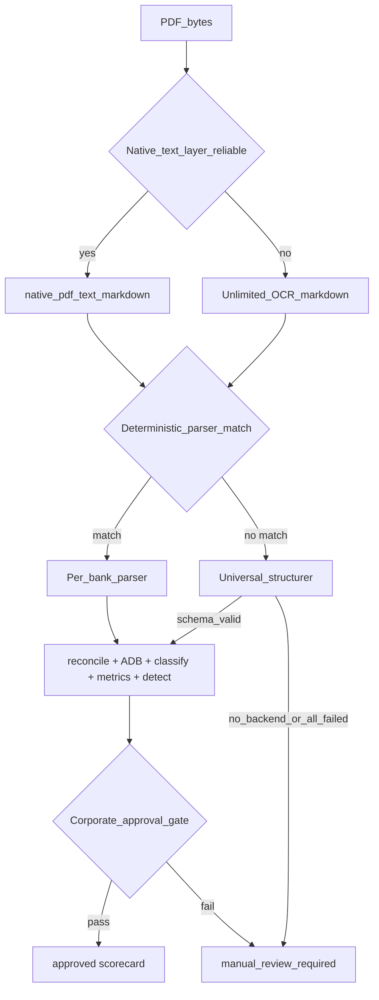

# Frozen Analysis Contract + Universal Statement Structurer — Design

**Date:** 2026-08-04
**Status:** Approved (plan `bank_statement_platform`, todos `lock-math-contract`,
`universal-structurer`, `unknown-bank-corpus`)

## Purpose

Two things, in this order:

1. **Lock the math.** Declare §1–§10 of the analysis contract, together with
   [`docs/transaction-classification.md`](../../transaction-classification.md), as
   the frozen product contract. The modules that implement it are closed to
   semantic change; new work extends registries, parsers, tests and serializers
   around them.
2. **Close the "any bank" gap.** Add a schema-constrained universal structurer so
   a never-before-seen layout can reach the *same* deterministic gate as a
   certified layout, and fail closed to manual review when the gate does not
   pass.

The rule that makes (2) safe is (1): the universal path may only fill
[`analysis/schema.py`](../../../analysis/schema.py) `Statement`. It never
produces a total, an average, a rate or an approval.

## Part 1 — The frozen contract (§1–§10)

### Frozen modules

| § | Contract | Implementation | Status |
|---|---|---|---|
| 1 | Signed transaction totals | `analysis/metrics.py` | frozen |
| 2 | Closing-balance reconciliation | `analysis/reconcile.py` | frozen |
| 3 | Average Daily Balance | `analysis/adb.py` | frozen |
| 4 | Cash flow | `analysis/metrics.py` | frozen |
| 5 | Withholding rate + potential exposure | `analysis/metrics.py`, `analysis/revenue.py` | frozen |
| 6 | Revenue triad | `analysis/metrics.py`, `analysis/transaction_classifier.py` | frozen |
| 7 | One canonical classification state per row | `analysis/transaction_classifier.py` | frozen |
| 8 | Lender metrics (confirmed vs potential, recurrence ≥ 3) | `analysis/detect.py` | frozen |
| 9 | Insurance counts and totals | `analysis/detect.py`, `analysis/metrics.py` | frozen |
| 10 | Corporate approval gate, fail closed | `analysis/pipeline.py` (`assess_quality`, `assess_document_integrity`) | frozen semantics |

"Frozen" means: **no semantic change.** Permitted work on these modules is
limited to added tests, added documentation, and additive helpers that do not
alter any produced value. Anything that would move a number requires an explicit
new contract decision, not a refactor.

### §1 Signed transaction totals

Amounts are signed on the `Transaction` row: negative leaves the account,
positive enters it. Line-item totals (`total_deposits`, `total_withdrawals`,
`num_deposits`, `num_withdrawals`) come only from parsed rows.

**Effective** totals (`effective_total_deposits`, `effective_total_withdrawals`,
and their counts) use the bank-stated summary **only when that summary
reconciles**; otherwise they fall back to line-item totals. The chosen basis is
always reported in `deposits_source` / `withdrawals_source`
(`bank_stated_reconciled`, `bank_stated_unverified`, `line_items`).

### §2 Closing-balance reconciliation

`reconcile()` runs, and reports, all of:

- **Sum check** — `beginning + Σ(signed amounts) == printed ending`, to the cent
  (0.01 tolerance). When the beginning balance is missing it is implied from
  ending − stated credits + stated debits.
- **Running-balance continuity** — `previous printed balance + intervening
  amounts == this printed balance`; breaks are counted, the first five are
  described.
- **Bank-stated summary self-consistency** (`summary_ok`) —
  `beginning + credits − debits (− service charge) (+ interest) == ending`,
  accepted with the service charge either separate or folded into debits. This is
  the backbone signal for small-bank and scanned statements where line-item
  detail is incomplete but the printed summary is authoritative.
- **Credit / debit coverage** — captured line items vs the bank-stated totals,
  pass band 0.98–1.02, with a service-charge-aware debit target.
- **Reversal-adjusted coverage** — when raw coverage misses, settlement
  reversals and the debits they reverse are netted out and the closer figure is
  used; `coverage_adjusted_for_reversals` and `reversal_pair_count` record that.
- **Missing detail** — surfaced as coverage issues plus `UNCAPTURED` aggregate
  rows, which block transaction-level approval.
- **Posting-date coverage** — proven in `adb.py` against the source text
  (`posting_dates_cover_source`), because folded posting dates still reconcile
  arithmetically while corrupting the daily ledger.

`ok` is true only when there are **no** issues at all.

### §3 Average Daily Balance

`ADB = Σ(each calendar day's ending ledger balance) / calendar days`, over every
inclusive day of the statement period. Every day contributes exactly once;
no-activity days carry the previous ending balance; negative balances stay
negative. Money is `Decimal` with `ROUND_HALF_UP` to the cent.

A bank-printed dated daily-balance history outranks reconstruction for the days
it covers (`source = bank_daily_summary`); other days are `reconstructed` or
`carried`. Printed running balances are validation evidence only.

Alongside the average: `daily_balance_sum`, `calendar_day_count`, lowest and
highest balance, negative-day count, and the reconstructed-vs-carried split, plus
the full validation suite (`statement_period_dates_valid`,
`all_transactions_dated`, `transactions_within_period`,
`bank_daily_balance_dates_valid`, `daily_balance_count_equals_calendar_days`,
`daily_balances_contiguous`, `covers_opening_day`, `covers_closing_day`,
`final_balance_matches_statement_closing`, `ledger_reconciles_to_closing`,
`running_balances_support_daily_ledger`, `posting_dates_cover_source`). A
bank-printed average is comparison evidence only
(`agrees_with_bank_stated_average`) and never required.

### §4 Cash flow

`cash_flow = effective_total_deposits − effective_total_withdrawals`.

### §5 Withholding

`eligible_deposits = effective_total_deposits − recognized lender funding
credits` in the default `legacy_eligible_deposits` mode.
`WITHHOLDING_DENOMINATOR_MODE=verified_revenue` opts into verified classified
revenue instead; the legacy value `confirmed_true_revenue` normalizes to
`verified_revenue`. The mode is never switched implicitly.

`withholding_rate = abs(total qualifying lender debits) / eligible_deposits *
100`. A zero or missing denominator returns no rate and sets
`withholding_review_required`.

Potential exposure is a **separate** metric over the same denominator:
`potential_withholding_exposure = abs(potential_lender_debit_total) /
eligible_deposits * 100`, retained at full internal precision and rounded only
for display. A material potential debit sets
`potential_withholding_review_required` even when confirmed withholding is 0%.

### §6 Revenue triad

Every posted credit is exactly one of `verified_revenue`, `unverified_deposit`,
`non_revenue`, and

`verified + unverified + non_revenue == total posted credits`

with `maximum_revenue = verified + unverified`. `compute_metrics` raises when a
posted credit does not carry exactly one revenue flag; `revenue_reconciles`
requires both a zero delta and matching counts.

### §7 One canonical classification state per transaction

Each row gets one state from the list in
[`docs/transaction-classification.md`](../../transaction-classification.md), and
the pipeline builds that list **once**, then passes the same records to metrics,
detection, serialization, exports and the UI. Consumers use contribution flags;
nobody re-scans descriptions.

### §8 Lender metrics

Confirmed vs potential lender counts, totals and evidence come from contribution
flags. Recurrence requires **at least three** matching transactions grouped by
canonical entity plus normalized amount, and recurrence alone is never lender
evidence.

### §9 Insurance

Insurance counts and totals come from posted insurance debit rows via
`contributes_to_insurance_totals`; insurance aliases outrank lender rules.

### §10 Corporate approval gate — fail closed

`assess_quality` + `assess_document_integrity` decide `quality.corporate_use`:

- `approved` — reconciliation fully OK and zero aggregate `UNCAPTURED` rows.
- `summary_only` — reconciles but is aggregate-backed.
- `manual_review_required` — anything else, including a reconciling summary with
  unreliable detail, a document-integrity issue, or a non-statement document.

Integrity flags (`summary_math_inconsistent`, `ledger_sum_mismatch`,
`running_balance_breaks`, coverage mismatches,
`transaction_detail_not_corporate_reliable`, `not_a_formal_statement`,
`conflicting_statement_summaries`, `missing_declared_statement_page`) downgrade
an otherwise-passing result. A possible document issue can never leave a
non-approved result approved.

**Nothing may promote a result to `approved` except these checks passing.**

## Part 2 — The universal "any bank" path

### Routing



Document source selection reuses the existing OCR routing in
[`ocr/pipeline.py`](../../../ocr/pipeline.py): layout-aware native extractors,
then generic `parse_native_pdf_text` when the text layer carries enough text,
then Unlimited-OCR page rasterization. `force_ocr=True` skips the native attempt.
The universal path records which source it used
(`native_pdf_text` / `ocr_markdown` / `provided_markdown`) so review queues can
tell a scan from a digital statement.

### Structurer interface (`analysis/universal.py`)

A structurer is a named callable that fills the schema and nothing else:

```python
class StatementStructurer(Protocol):
    name: str
    def __call__(self, markdown: str, *, feedback: str | None = None) -> Statement: ...
```

- `feedback` carries the previous attempt's reconciliation issues, enabling a
  targeted re-extract rather than a blind retry.
- Returning anything other than a schema-valid `Statement` is a failure, not a
  partial result.
- Provided backends: `CallableStructurer` (local models, replay corpora, tests)
  and `GeminiStructurer` (vendor; opt-in only).

### Escalation ladder

`structure_statement()` walks the configured backends in order and applies the
same escalation rule the pipeline already uses:

1. Structure with backend *n*, normalize, apply repairs, `reconcile()`.
2. Accept immediately when `recon.ok`.
3. Otherwise escalate when the summary did not reconcile
   (`summary_ok is not True`), passing the issues back as feedback.
4. Keep a later attempt only when it reconciles, or its summary reconciles while
   the incumbent's did not, or it has strictly fewer issues at equal summary
   status.
5. Every attempt is recorded (`stage`, `backend`, `ok`, `summary_ok`,
   `issue_count`, `error`) for audit.

A backend raising is recorded and does not abort the ladder. When no attempt
yields a `Statement`, the outcome is manual review with a stated reason.

### Zero-vendor-cost policy

`PROJECT_GOAL.md` requires the production path to stay at negligible marginal
cost and to route an unsupported format to review rather than to a vendor call.
The universal entry points therefore default to `allow_vendor_structurer=False`:

- Deterministic parser match → deterministic route, no structurer at all.
- No match, no local structurer configured → `route="unstructured"`,
  `corporate_use="manual_review_required"`, reason recorded. **No vendor call.**
- No match, vendor explicitly allowed → Gemini ladder runs, and its output still
  has to clear reconcile + ADB + the approval gate.

### Trust boundary

- The structurer may fill `Statement` fields.
- It may not compute totals, averages, rates, counts or approvals.
- `reconcile()` and the corporate approval gate are the only things that grant
  trust, and they are frozen.
- Failure returns manual review with a reason — never a plausible estimate.
- A successful attempt is not evidence about the layout in general; layout
  promotion to a deterministic parser is a separate certification decision.

## Part 3 — Unknown-bank corpus + eval harness

### Corpus

`tests/fixtures/unknown_banks/<case>/` holds:

| File | Role |
|---|---|
| `statement.md` | the document source of truth (native-text or OCR markdown) |
| `structured.json` | recorded structurer output: one `Statement`, or a list to replay the escalation ladder attempt by attempt |
| `case.json` | category, notes, and the expected gate outcome |

Categories: `never_seen`, `small_bank`, `scanned`. Cases deliberately include
statements that must **not** approve (mangled summary, incomplete scanned detail,
a missing declared page), because the corpus measures fail-closed behavior as
much as it measures success.

Replaying a recorded structuring keeps the harness deterministic and offline: it
measures the gate, which is the part that decides trust. `--live` swaps in a real
structurer to measure the model as well.

### Harness

`eval_unknown_banks.py` reports, per statement: route, document source, backend
used, whether it parsed, whether it reconciled, whether the summary reconciled,
whether ADB validated, `corporate_use`, approved vs manual review, and the
failure reason. It then prints approve / review / parse rates, and exits non-zero
when a case deviates from its recorded expectation (`--check`) so the corpus works
as a regression gate.

## Testing

- `tests/test_universal_structurer.py` — ladder behavior (accept on reconcile,
  escalate on summary failure, keep the better attempt, record errors), the
  zero-vendor-cost default, the fail-closed outcome when every backend fails, the
  trust boundary (a structurer inventing totals still cannot be approved), and
  the corpus expectations plus measured approve/review rates.
- Frozen modules get tests only; existing suites (`tests/test_adb.py`,
  `tests/test_analysis.py`, `tests/test_revenue_classification.py`,
  `tests/test_transaction_classifier.py`, `tests/test_new_statement_corpus.py`)
  continue to pin §1–§10.

## Out of scope here

- Automatic promotion of a repeatedly-successful layout to a deterministic parser
  (certification path, later).
- A local (non-vendor) structuring model implementation; the interface and policy
  exist, the backend is a deployment choice.
- Durable jobs, versioned API, webapp hardening, scorecard breadth (other plan
  todos, other owners).
